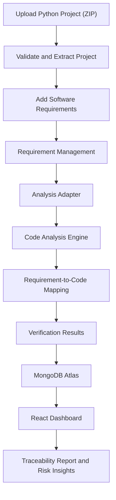
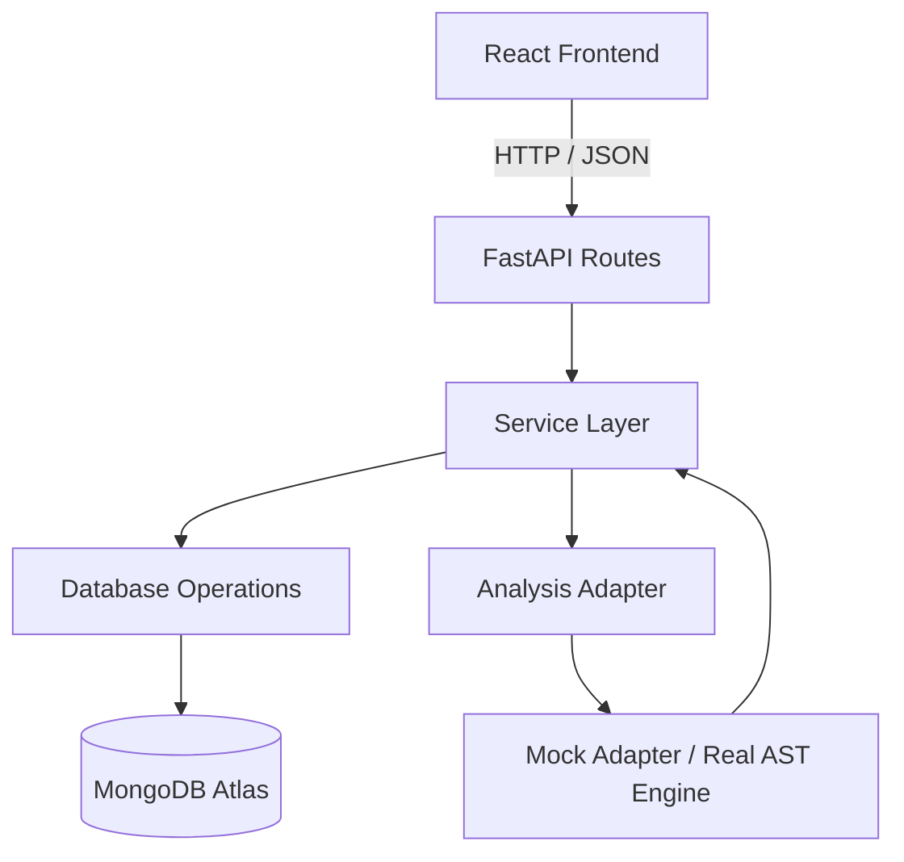

https://spectrace-one.vercel.app

# SpecTrace — AI-Powered Software Requirement Traceability & Verification

> **From written requirements to evidence-backed implementation insights.**

SpecTrace is a software requirement traceability and verification platform designed to help development teams understand whether their software requirements are reflected in their Python codebase.

It analyses uploaded Python projects, processes software requirements, and generates a requirement-by-requirement traceability report. Instead of relying only on keyword matches, SpecTrace aims to connect each requirement with relevant source-code evidence, implementation status, and associated test files.

---

## Table of Contents

1. [The Problem](#1-the-problem)
2. [Our Solution](#2-our-solution)
3. [Key Features](#3-key-features)
4. [How SpecTrace Works](#4-how-spectrace-works)
5. [System Architecture](#5-system-architecture)
6. [Technology Stack](#6-technology-stack)
7. [Getting Started](#7-getting-started)
8. [MongoDB Atlas Configuration](#8-mongodb-atlas-configuration)
9. [Running the Backend](#9-running-the-backend)
10. [API Documentation](#10-api-documentation)
11. [Analysis Engine](#11-analysis-engine)
12. [Database Design](#12-database-design)
13. [Security and Reliability](#13-security-and-reliability)
14. [Current MVP Scope and Limitations](#14-current-mvp-scope-and-limitations)
15. [Future Enhancements](#15-future-enhancements)
16. [Project Structure](#16-project-structure)
17. [Testing](#17-testing)
18. [Troubleshooting](#18-troubleshooting)

---

## 1. The Problem

Software development begins with requirements, but those requirements do not always remain connected to the actual implementation.

As projects grow:

- Requirements become difficult to track across multiple files.
- Developers may struggle to identify which functions implement specific requirements.
- Missing or partially implemented functionality can go unnoticed.
- Finding relevant code and associated tests becomes time-consuming.
- Changes to the codebase can introduce gaps that are difficult to identify manually.

This creates a gap between **what software is expected to do and what its implementation actually contains.**

## 2. Our Solution

**SpecTrace bridges the gap between software requirements and source-code implementation.**

It provides a structured workflow to:

1. Upload a Python project as a ZIP archive.
2. Add software requirements individually or in batches.
3. Analyse the project using a configurable analysis engine.
4. Map requirements to relevant source-code evidence.
5. Generate a traceability report with implementation statuses.
6. Identify requirements that need further investigation.

The goal is to make requirement verification more organised, explainable, and efficient.

## 3. Key Features

### 3.1 Project Upload and Management
- Upload Python projects in ZIP format.
- Validate uploaded archives before extraction.
- Store project metadata and file counts.
- Maintain separate project records.

### 3.2 Requirement Management
- Add multiple requirements to a project.
- Assign unique identifiers to individual requirements.
- Retrieve previously submitted requirements.
- Add new requirements without replacing existing ones.

### 3.3 Codebase Analysis
- Inspect supported Python source files.
- Identify relevant functions and code locations.
- Use a configurable analysis adapter.
- Associate implementation evidence with individual requirements.

### 3.4 Requirement Traceability Matrix
- Map requirements to related source files.
- Display code evidence and line references where available.
- Show the implementation status of each requirement.
- Keep results organised in requirement order.

### 3.5 Risk and Coverage Insights
- Identify potentially missing requirements.
- Highlight partially implemented requirements.
- Distinguish unverified requirements from verified findings.
- Present analysis summaries through the frontend dashboard.

### 3.6 Evidence-Backed Verification

A key design principle of SpecTrace is that analysis results should be accompanied by supporting evidence.

For example, a requirement may be associated with:
- A source file.
- A function or relevant code location.
- A line number, when available.
- An explanation of the analysis result.
- Related test files, when identified.

Finding a related function or test file does not automatically prove that the requirement works correctly. SpecTrace distinguishes code-level evidence from actual test execution.

---

## 4. How SpecTrace Works



### Workflow Explanation

| Stage | Description |
|---|---|
| 1. Upload | User uploads a Python project ZIP archive. |
| 2. Validate | Backend validates the archive and safely extracts supported files. |
| 3. Add requirements | User submits software requirements. |
| 4. Analyse | Analysis service sends project information and requirements to the configured engine. |
| 5. Map | Engine identifies potential code-level evidence for each requirement. |
| 6. Store | Results and supporting evidence are saved in MongoDB Atlas. |
| 7. Report | Frontend retrieves and displays requirement-level results. |

---

## 5. System Architecture

SpecTrace follows a modular backend architecture that separates HTTP handling, business logic, database operations, and code analysis.



### Architectural Components

**Frontend — React**
- Project upload interface.
- Requirement management interface.
- Project dashboard.
- Traceability and analysis report.

**API Layer — FastAPI**
- Receives HTTP requests.
- Validates incoming data.
- Calls the appropriate service.
- Returns structured responses.

**Service Layer**
- Contains project, requirement, and analysis business logic.
- Coordinates database and analysis operations.
- Handles workflow and status updates.

**Database Layer**
- Centralises MongoDB interactions.
- Provides reusable database operations.
- Manages project, requirement, and result records.

**Analysis Layer**
- Provides a standard interface for analysis engines.
- Supports a mock adapter and a configurable real analysis engine.
- Validates engine output before storing results.

**Design principle:** Routes handle HTTP communication, services handle business logic, and `database/operations.py` is the only module that directly communicates with MongoDB.

---

## 6. Technology Stack

| Component | Technology | Purpose |
|---|---|---|
| Frontend | React, JavaScript | User interface and dashboard |
| Backend | Python, FastAPI | REST API and application logic |
| Validation | Pydantic | Request and response validation |
| Database | MongoDB Atlas | Persistent project and analysis storage |
| Database Driver | PyMongo | MongoDB connectivity and operations |
| Code Analysis | Python AST and static-analysis logic | Python source-code inspection |
| Testing | Pytest, mongomock | Backend testing |
| API Documentation | FastAPI Swagger UI | Interactive API documentation |

*Only list additional technologies, such as Gemini or document-parsing libraries, as implemented components if they are actually integrated into the submitted version.*

---

## 7. Getting Started

### Prerequisites

Install the following before running the backend:

- Python 3.10 or later.
- pip.
- MongoDB Atlas account.
- Git (if cloning the repository).

### Step 1: Clone the repository

```bash
git clone <YOUR_GITHUB_REPOSITORY_URL>
cd <YOUR_PROJECT_FOLDER>
```

### Step 2: Navigate to the backend

```bash
cd backend
```

### Step 3: Create a virtual environment

**Windows — Command Prompt:**

```cmd
python -m venv venv
venv\Scripts\activate
```

**Linux / macOS:**

```bash
python -m venv venv
source venv/bin/activate
```

### Step 4: Install dependencies

```bash
pip install -r requirements.txt
```

### Step 5: Configure environment variables

Copy the example environment file.

**Windows:**

```cmd
copy .env.example .env
```

**Linux / macOS:**

```bash
cp .env.example .env
```

Add your MongoDB Atlas configuration to `.env`:

```env
MONGODB_URI=mongodb+srv://<username>:<password>@<cluster-url>/
MONGODB_DB_NAME=spectrace
ANALYSIS_ENGINE=mock
```

Replace the placeholders with your actual credentials.

Do not commit `.env` to GitHub.

---

## 8. MongoDB Atlas Configuration

SpecTrace uses MongoDB Atlas for persistent storage.

### Setup Instructions

1. Create a MongoDB Atlas account.
2. Create a free M0 cluster.
3. Open **Database Access** and create a database user.
4. Open **Network Access** and configure an IP access rule.
5. Select **Connect → Drivers → Python**.
6. Copy the MongoDB connection string.
7. Replace the username, password, and cluster details.
8. Add the connection string to your backend `.env` file.

For a temporary hackathon demonstration, Atlas allows an IP access rule of `0.0.0.0/0`. This permits connections from any IP and should be replaced with restricted access for production.

### Collections

The application creates the required collections and indexes automatically when configured to do so.

- `projects`
- `requirements`
- `analysis_results`

Database name:

```text
spectrace
```

---

## 9. Running the Backend

From the `backend` directory, activate the virtual environment and run:

```bash
uvicorn app.main:app --reload --port 8000
```

When the server starts successfully, open:

**Backend health check:**

http://localhost:8000/

The expected healthy response should indicate that the database is connected.

**Interactive API documentation:**

http://localhost:8000/docs

**OpenAPI schema:**

http://localhost:8000/openapi.json

The frontend must use the same backend host and port configured here.

---

## 10. API Documentation

SpecTrace exposes REST API endpoints for project management, requirement management, and analysis.

### 10.1 Project APIs

| Method | Endpoint | Description |
|---|---|---|
| GET | `/` | Backend and database health check |
| POST | `/projects/upload` | Upload a Python project ZIP |
| GET | `/projects` | Retrieve all projects |
| GET | `/projects/{id}` | Retrieve a specific project |

**Project upload**

Request type: `multipart/form-data`

Fields:
- `file`: Python project ZIP archive.
- `project_name`: Optional project name.

Example:

```bash
curl -X POST http://localhost:8000/projects/upload \
  -F "file=@student_app.zip" \
  -F "project_name=Student App"
```

### 10.2 Requirement APIs

| Method | Endpoint | Description |
|---|---|---|
| POST | `/projects/{id}/requirements` | Add requirements to a project |
| GET | `/projects/{id}/requirements` | Retrieve project requirements |

Example request:

```json
{
  "requirements": [
    "Users must be able to register",
    "Users must be able to log in",
    "Passwords must be validated"
  ],
  "replace": false
}
```

Submit this JSON to:

```text
POST /projects/{project_id}/requirements
```

When `replace` is false, new requirements are added without replacing the existing ones. When true, existing requirements are replaced according to the backend implementation.

### 10.3 Analysis APIs

| Method | Endpoint | Description |
|---|---|---|
| POST | `/projects/{id}/analyze` | Start requirement analysis |
| GET | `/projects/{id}/results` | Retrieve analysis results |

Example:

```bash
curl -X POST http://localhost:8000/projects/project_3f9a1c2b7d10/analyze
```

Retrieve results:

```bash
curl http://localhost:8000/projects/project_3f9a1c2b7d10/results
```

### 10.4 Verification Statuses

Each requirement receives one of the following statuses:

| Status | Meaning |
|---|---|
| `implemented` | Analysis found evidence supporting implementation. |
| `partially_implemented` | Some relevant implementation evidence was identified, but coverage appears incomplete. |
| `missing` | The configured engine found no matching implementation evidence. |
| `not_verified` | The available evidence is insufficient to determine implementation status. |

These statuses represent analysis findings, not a guarantee that the software behaves correctly at runtime.

### 10.5 Error Handling

API errors use a consistent response structure:

```json
{
  "error": {
    "code": "not_found",
    "message": "Project not found",
    "details": []
  }
}
```

Supported error categories include:

| HTTP Status | Error Code | Meaning |
|---|---|---|
| 400 | `bad_input` | Invalid input or ZIP archive |
| 404 | `not_found` | Requested resource does not exist |
| 409 | `analysis_running` | Analysis is already running |
| 413 | `file_too_large` | Upload exceeds the configured limit |
| 422 | `validation_error` | Request validation failed |
| 502 | `engine_error` | Analysis engine returned invalid output |
| 503 | `database_unavailable` | Database is unavailable |

---

## 11. Analysis Engine

SpecTrace uses an adapter-based design to separate the analysis workflow from the underlying analysis implementation.

This makes it possible to switch between a mock adapter and a real analysis engine without changing the API routes or service workflow.

### 11.1 Mock Adapter

The mock adapter is intended for development and demonstration of the backend workflow.

Its behaviour is deliberately transparent:

- It does not invent implementation evidence.
- All requirements receive the `not_verified` status.
- Results contain `is_mock: true`.
- Explanations identify the result as mock output.

The frontend should display a visible **DEMO DATA / MOCK ANALYSIS** indicator whenever `is_mock` is true.

### 11.2 Real AST Analysis Engine

The real analysis engine can inspect Python source code using static-analysis techniques.

Its responsibilities include:

- Receiving project metadata and requirements.
- Inspecting supported Python files.
- Identifying relevant code locations.
- Returning requirement-level evidence.
- Providing a status and explanation for each requirement.

### 11.3 Engine Contract

The analysis engine must expose:

```python
def analyze(request: dict) -> dict:
    ...
```

**Input structure:**

```json
{
  "project_id": "project_123",
  "project_path": "/internal/project/path",
  "python_files": [
    "auth.py",
    "main.py"
  ],
  "requirements": [
    {
      "id": "requirement_123",
      "description": "Users must be able to log in"
    }
  ]
}
```

**Expected output structure:**

```json
{
  "engine_name": "SpecTrace AST Engine v1",
  "is_mock": false,
  "results": [
    {
      "requirement_id": "requirement_123",
      "status": "implemented",
      "evidence": [
        {
          "file": "auth.py",
          "line": 25,
          "description": "Related login function identified"
        }
      ],
      "test_status": "not_run",
      "explanation": "Relevant implementation evidence was identified."
    }
  ]
}
```

The backend validates the engine output before saving results.

- Unknown requirement IDs are rejected.
- Invalid result structures produce an analysis error.
- Requirements omitted by the engine are stored as `not_verified`.
- Previous analysis results for the same project are replaced when analysis is run again.

### 11.4 Enabling the Real Engine

Configure the backend environment:

```env
ANALYSIS_ENGINE=real
```

The real engine package must be available and satisfy the documented contract.

Restart the backend after changing the configuration.

**Important:** Setting this environment variable alone does not create a real analysis engine. The corresponding implementation must exist and be connected through the adapter.

---

## 12. Database Design

SpecTrace uses three primary MongoDB collections.

### 12.1 Projects

Stores uploaded project information.

| Field | Description |
|---|---|
| `_id` | Unique project identifier |
| `project_name` | Project name |
| `filename` | Uploaded ZIP filename |
| `language` | Detected or supported language |
| `status` | Current project status |
| `python_file_count` | Number of Python files |
| `total_file_count` | Number of supported files |
| `storage_path` | Internal extracted project location |
| `created_at` | Project creation timestamp |
| `last_analyzed_at` | Most recent analysis timestamp |

### 12.2 Requirements

Stores individual requirements associated with projects.

| Field | Description |
|---|---|
| `_id` | Unique requirement identifier |
| `project_id` | Associated project |
| `description` | Requirement text |
| `status` | Requirement status |
| `created_at` | Creation timestamp |

### 12.3 Analysis Results

Stores the output of requirement analysis.

| Field | Description |
|---|---|
| `_id` | Unique result identifier |
| `project_id` | Associated project |
| `requirement_id` | Associated requirement |
| `requirement_description` | Requirement text |
| `status` | Verification status |
| `evidence` | Supporting code evidence |
| `file_name` | Primary associated file |
| `line_number` | Primary associated line number |
| `test_status` | Test execution or discovery status |
| `explanation` | Analysis explanation |
| `engine` | Analysis engine name |
| `is_mock` | Indicates whether the result is mock output |
| `order` | Requirement order |
| `analyzed_at` | Analysis timestamp |

### Indexing Strategy

The backend creates indexes to support efficient retrieval:

- `projects.created_at`
- `requirements(project_id, created_at)`
- `analysis_results(project_id, order)`
- `analysis_results(project_id, requirement_id)`

Timestamps are stored as UTC BSON dates.

---

## 13. Security and Reliability

Security is considered throughout the project-upload and analysis workflow.

### ZIP Archive Validation

Uploaded archives are checked for:

- Valid ZIP format.
- Allowed file types.
- File-size limits.
- File-count limits.
- Expanded-size limits to reduce ZIP-bomb risk.
- Path traversal attempts.
- Absolute paths.
- Symlinks.
- Encrypted entries.

Each project is extracted into its own isolated directory.

### Safe Code Handling

**Uploaded source code is never imported or executed by the backend.**

The analysis process uses static inspection rather than executing uploaded project code.

This reduces the risks associated with processing untrusted source-code archives.

### Credential Protection

- Database credentials are stored in environment variables.
- `.env` is excluded from version control.
- Internal server file paths are not exposed through API responses.

### Error Handling

The backend uses structured error responses and handles common upload, validation, database, and analysis failures.

---

## 14. Current MVP Scope and Limitations

SpecTrace is designed as a focused MVP with a clear scope.

| Area | Current scope |
|---|---|
| Language support | Python-focused |
| Project input | ZIP archive |
| Requirement input | Text submitted through the requirements API |
| Code execution | Not permitted |
| Test execution | Not implemented |
| Test status | `not_run` unless supplied by the analysis engine |
| Authentication | Not included in the MVP |
| Rate limiting | Not included in the MVP |
| User-level project ownership | Not included in the MVP |

### Why is test execution not included?

Running arbitrary uploaded code or tests requires a secure sandbox with resource limits, execution timeouts, and isolation.

For the current MVP, SpecTrace avoids executing untrusted code.

Instead, it focuses on source-code inspection and evidence-based analysis.

This is an intentional security and feasibility decision.

### Access Control Note

Authentication and per-user project ownership are not included in this MVP. Anyone who can reach an unprotected API may be able to access available project records.

The current configuration is intended for a controlled demonstration environment, not unrestricted production deployment.

---

## 15. Future Enhancements

The modular architecture provides opportunities for further development.

**1. Multi-language support**
- Extend analysis to Java, JavaScript, and other programming languages.

**2. Advanced AI-assisted analysis**
- Improve requirement understanding and semantic code matching.
- Provide richer explanations and more useful evidence.

**3. Secure test execution**
- Introduce isolated containers and resource limits.
- Support controlled test execution and genuine test-result reporting.

**4. Version-control integration**
- Connect Git repositories.
- Analyse code changes and identify potentially affected requirements.

**5. Enhanced risk analytics**
- Add requirement coverage trends.
- Identify high-risk implementation areas.
- Compare results across project versions.

**6. Access control**
- Add user authentication.
- Introduce project ownership and role-based permissions.

---

## 16. Project Structure

```text
backend/
│
├── app/
│   ├── main.py
│   ├── config.py
│   │
│   ├── routes/
│   │   ├── projects.py
│   │   ├── requirements.py
│   │   └── analysis.py
│   │
│   ├── services/
│   │   ├── project_service.py
│   │   ├── requirement_service.py
│   │   └── analysis_service.py
│   │
│   ├── database/
│   │   ├── connection.py
│   │   └── operations.py
│   │
│   ├── schemas/
│   │   ├── project.py
│   │   ├── requirement.py
│   │   └── result.py
│   │
│   ├── analysis/
│   │   ├── contract.py
│   │   ├── adapter.py
│   │   └── mock_adapter.py
│   │
│   └── utils/
│       ├── file_handler.py
│       ├── errors.py
│       └── ids.py
│
├── tests/
├── docs/
├── uploads/
│
├── .env.example
├── .gitignore
├── requirements.txt
├── pytest.ini
└── README.md
```

The real analysis engine package can be added separately when implemented.

---

## 17. Testing

SpecTrace uses Pytest for backend testing.

Run the test suite from the backend directory:

```bash
pytest -v
```

The tests use `mongomock` to provide an in-memory MongoDB-like environment for database-related tests.

This allows most automated tests to run without a live Atlas connection.

The real database connection test is designed to skip when its required environment configuration is unavailable.

### Recommended Test Scenarios

- Backend health check.
- Valid project ZIP upload.
- Invalid ZIP upload.
- File-size and archive validation.
- Adding requirements to a project.
- Retrieving project requirements.
- Running mock analysis.
- Retrieving analysis results.
- Handling unknown project IDs.
- Handling invalid analysis-engine output.
- MongoDB connection failure handling.

---

## 18. Troubleshooting

### Backend cannot connect to MongoDB Atlas

Check:

- MongoDB URI in `.env`.
- Database username and password.
- Atlas network access configuration.
- Cluster availability.
- Internet connectivity.

If your password contains special characters, URL-encode them in the connection string.

### Frontend cannot reach the backend

Make sure the backend is running.

```bash
uvicorn app.main:app --reload --port 8000
```

Check that the frontend API base URL uses the same port.

### Analysis returns mock results

Check the backend environment:

```env
ANALYSIS_ENGINE=mock
```

Mock results are intentionally marked with `is_mock: true` and `not_verified` statuses.

For real analysis, the real engine package must be implemented and configured.

### Port already in use

Choose another available port and update the frontend API base URL accordingly.

---

## Conclusion

**SpecTrace aims to make software requirements traceable, implementation evidence visible, and verification gaps easier to investigate.**

By combining a modular backend, structured requirement management, static code analysis, and evidence-backed reporting, SpecTrace provides a foundation for more transparent software verification.

> **SpecTrace — Know what your software promises. Discover what your code supports.**